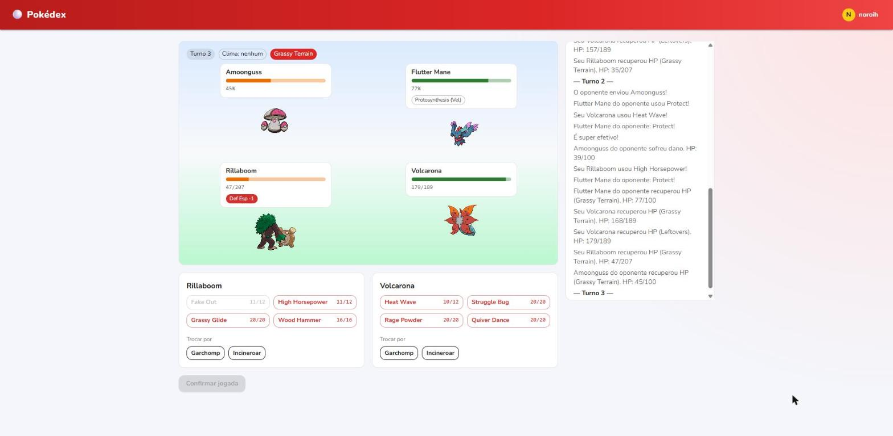
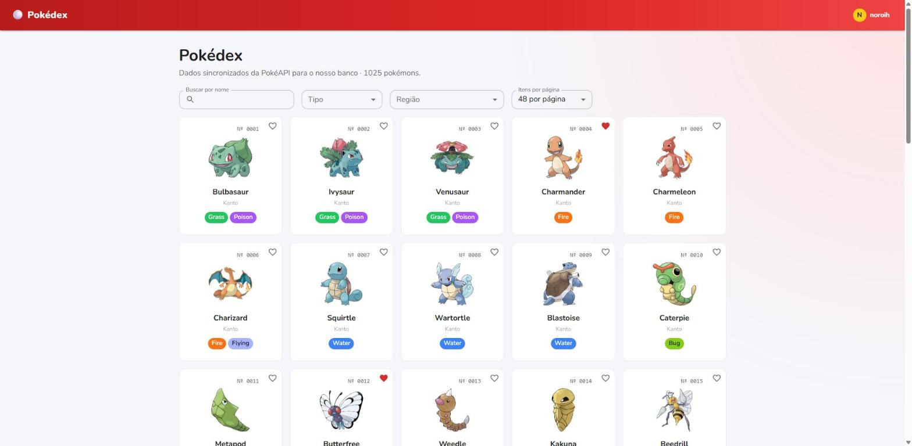
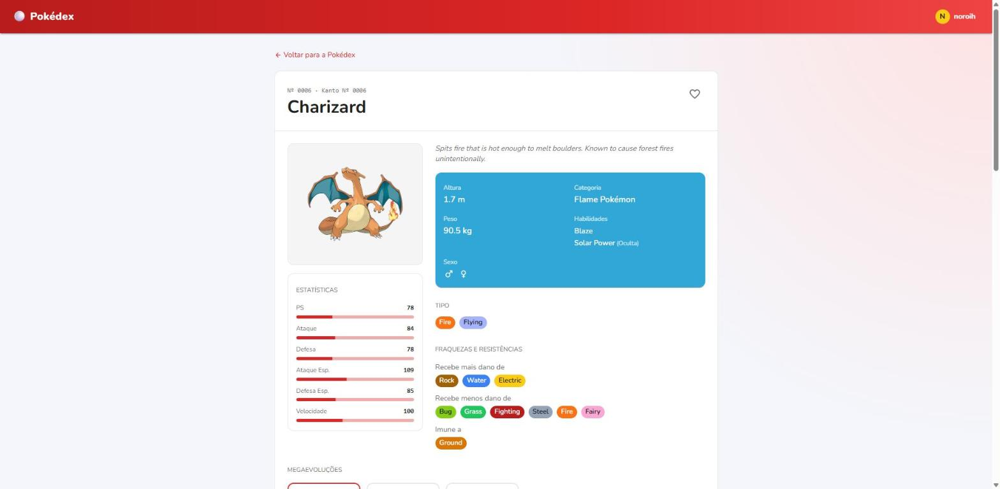
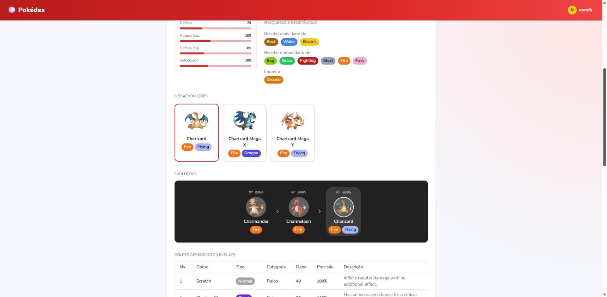
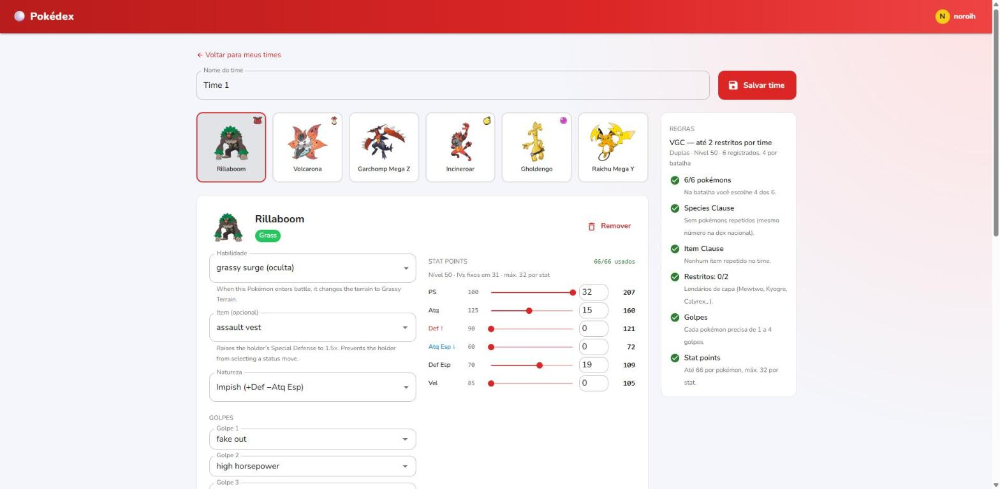
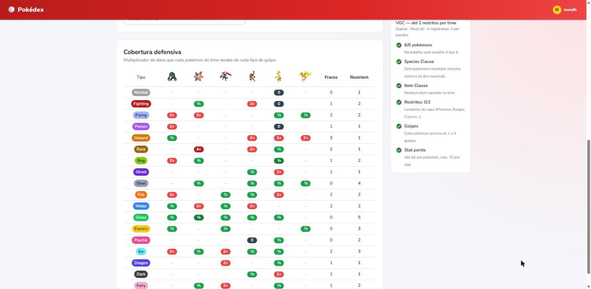
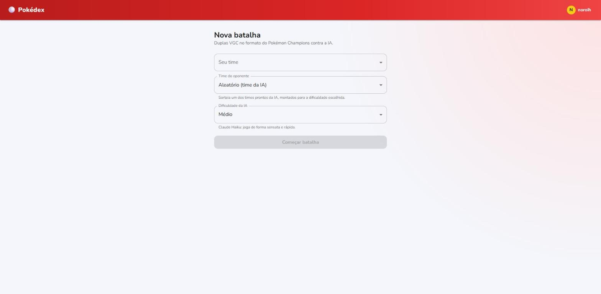
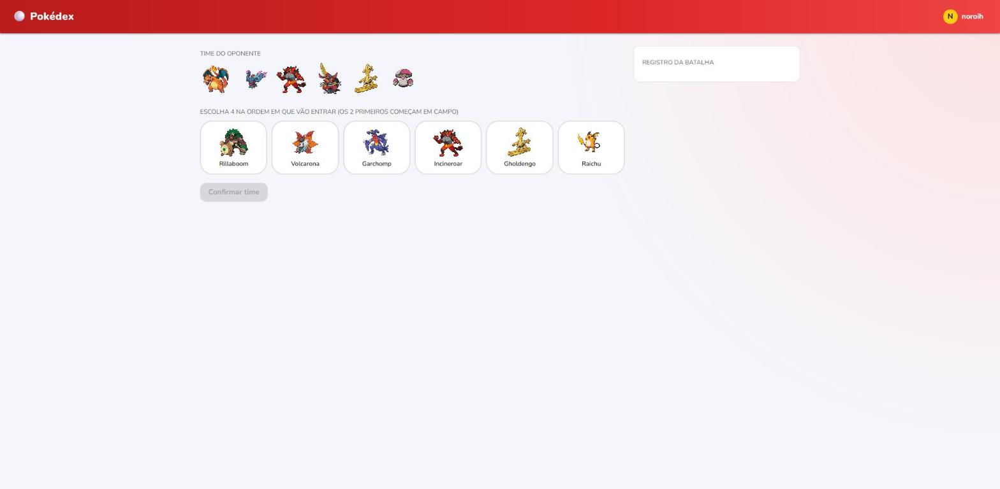
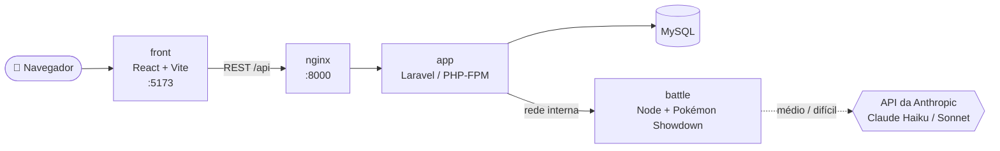
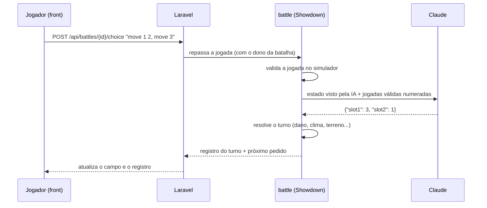

<div align="center">

# 🔴 Pokédex — Projeto Acadêmico

**Pokédex completa · Montador de times VGC · Batalhas em duplas contra uma IA (Claude)**




</div>

Aplicação full stack desenvolvida como projeto de faculdade: Pokédex completa (Gen 1 a 9, com megaevoluções), montador de times no formato **VGC (Pokémon Champions)** e **batalhas em duplas contra uma IA** com três dificuldades — as mais difíceis jogadas pelo Claude, da Anthropic.

Front-end em **React/TypeScript**, API em **Laravel**, banco **MySQL**, simulador de batalha em **Node.js** (Pokémon Showdown), tudo orquestrado com **Docker**.

## ✨ Funcionalidades

| | |
|---|---|
| 📖 **Pokédex** | Os 1025 pokémons (Gen 1 a 9, incluindo Hisui e Paldea) e as 97 megaevoluções, com busca, filtros por tipo/região, detalhes (estatísticas, fraquezas, linha evolutiva, golpes) e favoritos. |
| 🛠️ **Montador de times VGC** | 6 pokémons nível 50 com habilidade, item, natureza, até 4 golpes e Stat Points; validação das regras do VGC e tabela de cobertura defensiva do time. |
| ⚔️ **Batalhas em duplas** | Prévia de time (escolhe 4 de 6), golpes com alvo, troca, mega evolução, clima, terreno e todas as mecânicas do jogo, resolvidas pelo simulador do Pokémon Showdown. |
| 🤖 **IA com 3 dificuldades** | Fácil (jogadas aleatórias), médio (Claude Haiku) e difícil (Claude Sonnet), cada uma com seus próprios times prontos. |

## 📸 Telas

<table>
  <tr>
    <td width="50%"><p align="center"><b>Pokédex</b> — busca, filtros por tipo e região, favoritos</p></td>
    <td width="50%"><p align="center"><b>Detalhes</b> — estatísticas, habilidades, fraquezas e resistências</p></td>
  </tr>
  <tr>
    <td><p align="center"><b>Megaevoluções e evoluções</b> — cada forma com a sua página</p></td>
    <td><p align="center"><b>Montador de times</b> — Stat Points, natureza, item e regras do VGC em tempo real</p></td>
  </tr>
  <tr>
    <td><p align="center"><b>Cobertura defensiva</b> — fraquezas e resistências do time por tipo</p></td>
    <td><p align="center"><b>Nova batalha</b> — seu time, oponente (ou time aleatório da IA) e dificuldade</p></td>
  </tr>
  <tr>
    <td><p align="center"><b>Prévia de time</b> — veja o time do oponente e escolha seus 4</p></td>
    <td><p align="center"><b>Batalha</b> — campo, boosts, terreno, golpes com alvo e registro em português</p></td>
  </tr>
</table>

## 🧰 Tecnologias Utilizadas

### Front-end

| Tecnologia | Finalidade |
|---|---|
| React 19 + TypeScript | Biblioteca de interface e tipagem estática |
| Vite | Bundler e servidor de desenvolvimento |
| MUI (Material UI) v6 + Emotion | Componentes de interface e tema |
| Zustand | Estado global (sessão de autenticação) |
| React Router v7 | Roteamento client-side |
| Axios | Cliente HTTP |

### Back-end

| Tecnologia | Finalidade |
|---|---|
| Laravel 12 / PHP 8.3 | API REST, autenticação, times, regras do VGC |
| Autenticação via token | Implementação própria, análoga ao Laravel Sanctum |

### Serviço de batalha

| Tecnologia | Finalidade |
|---|---|
| Node.js 22 | Execução do serviço (`battle/`) |
| [`pokemon-showdown`](https://github.com/smogon/pokemon-showdown) | Simulador de batalha (mecânicas do Pokémon Champions) |
| [`@anthropic-ai/sdk`](https://github.com/anthropics/anthropic-sdk-typescript) | Chamadas ao Claude para a IA das dificuldades médio e difícil |

### Banco de Dados e Infraestrutura

| Tecnologia | Finalidade |
|---|---|
| MySQL 8.4 | Persistência dos dados |
| Docker / Docker Compose | Containerização e orquestração |
| Nginx | Servidor web da API (proxy para PHP-FPM) |
| phpMyAdmin | Interface administrativa do banco |

## 🏗️ Arquitetura

```
pokedex-projeto/
├── back/                 # API Laravel (times, regras VGC, autenticação, proxy das batalhas)
├── front/                # React + TypeScript + MUI
├── battle/               # Serviço de batalha: simulador Showdown + IA (Node.js)
│   ├── src/battle.js     #   batalha turno a turno, conversão de times, plano B da IA
│   ├── src/server.js     #   API HTTP interna
│   └── src/ai/           #   opções válidas, decisor aleatório, visão da IA, chamada ao Claude
├── docker/nginx/default.conf
├── docker-compose.yml
└── .env / .env.example   # credenciais do banco e chave da API usadas pelo docker-compose
```



Fluxo de um turno de batalha:



- O front-end só conversa com a API Laravel (`/api/...`).
- O serviço `battle` não é exposto fora do Docker: só o Laravel fala com ele, depois de autenticar o usuário e conferir que os times são dele.
- A chave da API da Anthropic existe apenas no container `battle`.

## 📋 Pré-requisitos

- [Docker Desktop](https://www.docker.com/products/docker-desktop/) instalado e em execução (no Windows, com virtualização e WSL2 habilitados).
- Opcional: uma chave da [API da Anthropic](https://console.anthropic.com) para as dificuldades médio e difícil. Sem ela, todas as dificuldades jogam no aleatório.

Não é necessária a instalação local de PHP, Composer, Node.js ou MySQL — tudo roda dentro dos containers.

## 🚀 Instalação e Execução

### Primeira execução

1. Clonar o repositório e acessar o diretório raiz do projeto.

2. Criar os arquivos de ambiente a partir dos exemplos:

   | Criar | A partir de | Observação |
   |---|---|---|
   | `.env` (raiz) | `.env.example` | Credenciais do MySQL e, opcionalmente, `ANTHROPIC_API_KEY` |
   | `back/.env` | `back/.env.example` | Manter as credenciais de banco iguais às do `.env` da raiz |
   | `front/.env` | `front/.env.example` | Endereço público da API |

3. Construir e iniciar os containers:
   ```
   docker compose up --build
   ```

   | Serviço | Descrição | Endereço |
   |---|---|---|
   | `app` | PHP-FPM executando a aplicação Laravel | — |
   | `nginx` | Servidor web da API | http://localhost:8000 |
   | `mysql` | Banco de dados | localhost:3306 |
   | `front` | Servidor de desenvolvimento Vite | http://localhost:5173 |
   | `battle` | Simulador de batalha e IA | — (rede interna) |
   | `phpmyadmin` | Interface administrativa do banco | http://localhost:8080 |

   As migrations são executadas automaticamente na inicialização do container `app`.

4. Popular a base de dados. Duas formas:

   - **Restaurando o dump do repositório** (recomendado, sem depender da PokéAPI). Contém só dados do jogo — pokémons (com megas), tipos, habilidades, golpes e itens; nenhum usuário. Rodar depois que as migrations criarem as tabelas; pode ser executado mais de uma vez sem duplicar nada:
     ```
     docker compose cp back/database/dump.sql mysql:/tmp/dump.sql
     docker compose exec mysql sh -c 'mysql -uroot -p$MYSQL_ROOT_PASSWORD pokedex < /tmp/dump.sql'
     ```
     (Funciona igual no PowerShell e no bash.)

   - **Sincronizando com a PokéAPI** (alguns minutos; também traz as megas):
     ```
     docker compose exec app php artisan pokedex:sync --from=1 --limit=1025
     docker compose exec app php artisan pokedex:sync-items
     ```
     `--from` e `--limit` definem a faixa da dex nacional (ex.: `--limit=151` só a Gen 1).

5. Cadastrar os times prontos da IA (depois de popular a base, pois usa pokémons, golpes e itens):
   ```
   docker compose exec app php artisan db:seed --class=AiTeamSeeder
   ```

6. Acessar a aplicação em **http://localhost:5173**.

### Execuções subsequentes

```
docker compose up -d
```

## 🛠️ Montagem de Times (VGC)

Usuários logados montam times em **Meus times** (menu do usuário), seguindo as regras do VGC 2026 (Pokémon Champions):

- Time com até 6 pokémons (com menos de 6 fica como rascunho); nas batalhas, 4 são escolhidos.
- Todos no nível 50, sem IVs (fixos em 31). Os EVs são substituídos por **Stat Points**: 66 no total, no máximo 32 por stat.
- **Species Clause**: sem dois pokémons com o mesmo número na dex nacional (vale também para forma base + mega).
- **Item Clause**: nenhum item repetido.
- **Megaevoluções**: aparecem na busca logo após a forma base. Uma mega precisa obrigatoriamente segurar a sua pedra; a forma base pode segurar a pedra ou qualquer outro item.
- No máximo **2 lendários restritos** (Mewtwo, Kyogre, Calyrex...). Míticos são proibidos.
- A tela mostra a **cobertura defensiva** do time (multiplicador de dano de cada tipo em cada membro).

As regras ficam em `back/config/vgc.php` (restritos, banidos, naturezas, pedras de cada mega) e são validadas no back-end por `App\Services\VgcTeamValidator`; o front lê as mesmas regras em `GET /api/vgc/rules`.

<p align="center">
  
  
</p>

## ⚔️ Batalhas contra a IA

Em **Batalhar** (menu do usuário): escolha o seu time, o time do oponente e a dificuldade. No time do oponente, **Aleatório** (padrão) sorteia um dos times prontos da IA da dificuldade escolhida; também é possível colocar a IA para jogar com um time seu.

- Formato: duplas do Pokémon Champions, prévia de time com 4 escolhidos de 6. Todas as mecânicas (dano, tipos, clima, terreno, habilidades, itens, megas) são do simulador do Pokémon Showdown.
- A tela mostra HP, status, boosts e efeitos de cada pokémon, clima, terreno e condições de cada lado, além do registro da batalha em português.
- O HP do oponente aparece em porcentagem, como no jogo.

<p align="center">
  
  
</p>

### Dificuldades

| Dificuldade | Quem joga | Times prontos (sorteio) | Custo aproximado por batalha |
|---|---|---|---|
| Fácil | Jogadas aleatórias válidas | Pokémon de começo de jogo, sem item, natureza neutra, Stat Points espalhados | grátis |
| Médio | Claude Haiku 5.5, sem raciocínio estendido | Times coerentes (equilíbrio, chuva, sol) com itens e Stat Points focados | ~US$ 0,001 |
| Difícil | Claude Sonnet 5.5, raciocínio em esforço baixo | Times competitivos com megas, Kyogre e Trick Room | ~US$ 0,03 |

Os times ficam em `back/database/data/ai_teams.json` (nomes como na PokeAPI; `stat_points` na ordem PS, Atq, Def, AtqEsp, DefEsp, Vel). Para mudar ou acrescentar times, edite o JSON e rode o `AiTeamSeeder` de novo: ele valida cada time com as mesmas regras do VGC dos times de usuário, lista todos os erros e só grava se tudo estiver válido. Os times da IA não têm dono, então não aparecem em "Meus times" e não podem ser abertos por usuários.

Como a IA funciona (`battle/src/ai/`):

- **Visão sem trapaça**: a IA recebe só o que o lado dela pode saber — o próprio time completo, e do jogador apenas espécie, HP em %, status, boosts e o que já foi revelado na batalha (golpes usados, item, habilidade).
- **Opções fechadas**: o simulador lista as jogadas válidas de cada pokémon; o Claude só responde os números escolhidos, em JSON com formato fixo. Uma jogada inválida nunca chega ao simulador.
- **Plano B**: se a resposta vier inválida, demorar ou a API falhar, a jogada cai no aleatório e a batalha segue. Sem chave da API, médio e difícil jogam no aleatório.
- **Custo mínimo**: prompt de sistema fixo e em cache, estado do turno compacto, resposta só com números e nenhuma chamada quando só há uma jogada possível. O uso de tokens de cada batalha aparece no log do container `battle`.

Os modelos de cada dificuldade podem ser trocados pelas variáveis `AI_MODEL_MEDIUM` e `AI_MODEL_HARD`.

## 🔐 Variáveis de Ambiente

| Arquivo | Variáveis relevantes |
|---|---|
| `.env` (raiz) | `DB_DATABASE`, `DB_USERNAME`, `DB_PASSWORD`, `DB_ROOT_PASSWORD`, `ANTHROPIC_API_KEY` (opcional) |
| `back/.env` | Configuração do Laravel (`APP_KEY`, credenciais do banco) e `BATTLE_SERVICE_URL` (padrão `http://battle:3000`) |
| `front/.env` | `VITE_API_URL` (padrão `http://localhost:8000/api`) |

Para a chave da API: criar em **console.anthropic.com → API Keys** (a cobrança é separada da assinatura do Claude), colocar `ANTHROPIC_API_KEY=...` no `.env` da raiz e recriar o container com `docker compose up -d battle`.

> **Segurança**: nenhum arquivo `.env` é versionado (estão no `.gitignore`); só os `.env.example`, sem valores secretos. Nunca coloque a chave da API no `front/.env` — tudo o que está lá vai para o navegador.

## ✅ Testes

```
docker compose exec app php artisan test     # back-end: times, regras VGC, batalhas (Laravel)
docker compose exec battle npm test          # serviço de batalha: simulador, clima/terreno, IA
docker compose exec front npm test           # front-end: leitura do log e montagem das jogadas
docker compose exec front npm run build      # checagem de tipos + build de produção
```

Os testes do serviço de batalha não chamam a API da Anthropic (não gastam créditos).

## 💻 Comandos Úteis

```
docker compose down                              # encerra os containers
docker compose exec app php artisan migrate      # executa migrations manualmente
docker compose exec app bash                     # shell no container da aplicação
docker compose logs -f battle                    # logs das batalhas (inclui uso de tokens da IA)
docker compose exec front npm install            # reinstala dependências do front-end
```

## 🪟 Observações (Windows)

- **Edições no serviço `battle` não recarregam sozinhas**: no Windows, o container não percebe arquivos alterados. Depois de mexer em `battle/`, rode `docker restart pokedex_battle`. (O Vite do front já usa verificação periódica e recarrega normalmente.)
- **Erro 502 na API depois de recriar o container `app`**: o nginx fica apontando para o container antigo. Resolva com `docker restart pokedex_nginx`.
- **Batalhas ficam em memória**: reiniciar o container `battle` encerra as batalhas em andamento.
- **Dependências novas**: os `node_modules` de `front` e `battle` ficam em volumes Docker que não são atualizados com o `package.json`. Depois de incluir uma dependência:
  ```
  docker compose exec front npm install && docker compose restart front
  docker compose exec battle npm install && docker compose restart battle
  ```
